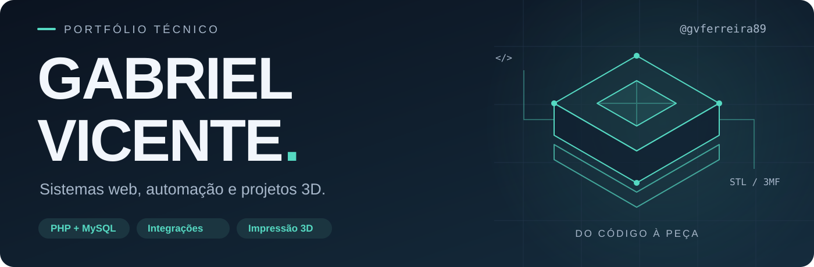
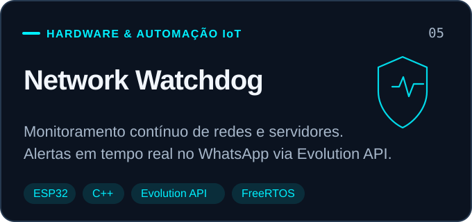
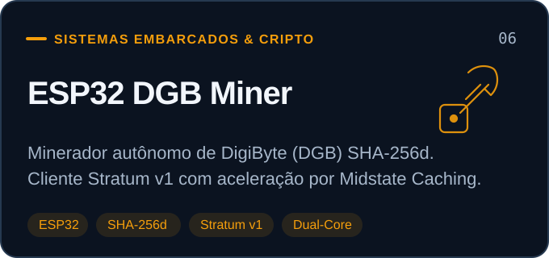
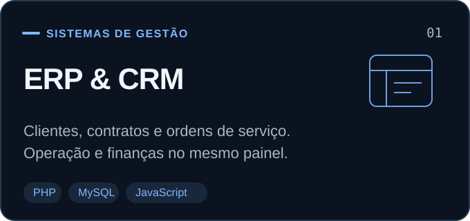
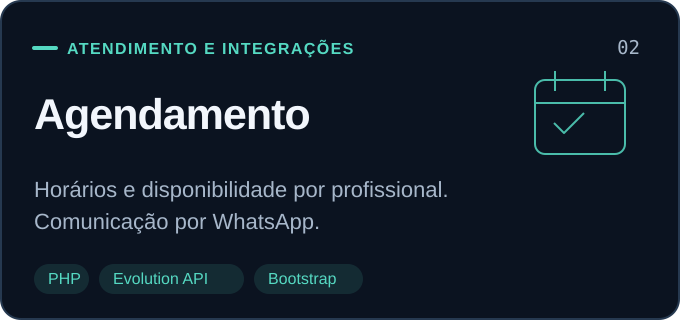
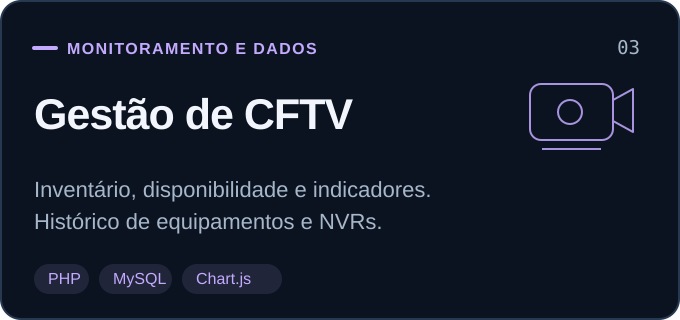
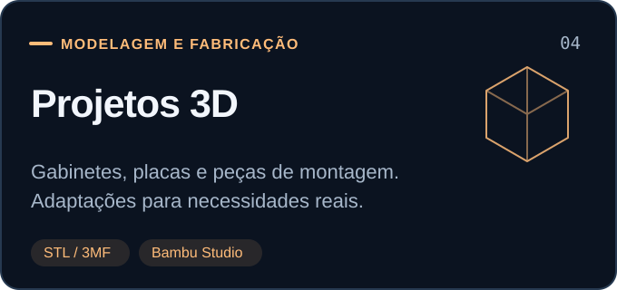

<picture>
  <source media="(prefers-color-scheme: dark)" srcset="assets/profile-banner-dark.svg">
  <source media="(prefers-color-scheme: light)" srcset="assets/profile-banner-light.svg">
  
</picture>

  <a href="#-projetos-open-source-em-destaque"><b>🚀 Projetos Open Source</b></a> &nbsp;•&nbsp;
  <a href="#-sistemas-corporativos--portfólio-privado"><b>💼 Soluções Privadas</b></a> &nbsp;•&nbsp;
  <a href="#%EF%B8%8F-stack-tecnológica"><b>🛠️ Tecnologias</b></a> &nbsp;•&nbsp;
  <a href="#-estatísticas--métricas"><b>📊 Estatísticas</b></a> &nbsp;•&nbsp;
  <a href="#%EF%B8%8F-do-código-à-peça"><b>🖨️ Projetos 3D</b></a>

---

### ⚡ Software para a operação. Hardware conectado. Peças para o mundo real.

Sou **Gabriel Vicente**. Desenvolvo ecossistemas completos integrando **software web corporativo**, **sistemas embarcados em microcontroladores ESP32** e **prototipagem física em impressão 3D**.

Do desenvolvimento de firmware de baixo nível e algoritmos de rede ao design de painéis administrativos em tempo real, construo soluções robustas voltadas para automação operacional, alta disponibilidade e monitoramento inteligente.

---

## 🚀 Projetos Open Source em Destaque

Aplicações e firmwares de hardware desenvolvidos em C++ com foco em eficiência, autonomia de rede e telemetria:

<table>
  <tr>
    <td width="50%" align="center">
      <a href="https://github.com/gvferreira89/ESP32-Network-Watchdog">
        <picture>
          <source media="(prefers-color-scheme: dark)" srcset="assets/cards/watchdog-dark.svg">
          <source media="(prefers-color-scheme: light)" srcset="assets/cards/watchdog-light.svg">
          
        </picture>
      </a>
       
      <a href="https://github.com/gvferreira89/ESP32-Network-Watchdog"><b>ESP32 Network Watchdog</b></a> 
      Watchdog autônomo com ICMP ping multi-alvo, relé de auto-recuperação de rede e alertas WhatsApp via Evolution API v2.
        
      
      
      
      
    </td>
    <td width="50%" align="center">
      <a href="https://github.com/gvferreira89/ESP32-DGB-Miner">
        <picture>
          <source media="(prefers-color-scheme: dark)" srcset="assets/cards/miner-dark.svg">
          <source media="(prefers-color-scheme: light)" srcset="assets/cards/miner-light.svg">
          
        </picture>
      </a>
       
      <a href="https://github.com/gvferreira89/ESP32-DGB-Miner"><b>ESP32 DGB Miner</b></a> 
      Minerador autônomo DigiByte (DGB) SHA-256d com cliente Stratum v1, aceleração Midstate Caching e Web Dashboard.
        
      
      
      
      
    </td>
  </tr>
</table>

---

## 💼 Sistemas Corporativos & Portfólio Privado

Aplicações e plataformas em produção com regras de negócio dedicadas. Os cartões abaixo descrevem o escopo funcional e as arquiteturas empregadas nestas soluções privadas:

<table>
  <tr>
    <td width="50%"><picture><source media="(prefers-color-scheme: dark)" srcset="assets/cards/erp-dark.svg"><source media="(prefers-color-scheme: light)" srcset="assets/cards/erp-light.svg"></picture></td>
    <td width="50%"><picture><source media="(prefers-color-scheme: dark)" srcset="assets/cards/agenda-dark.svg"><source media="(prefers-color-scheme: light)" srcset="assets/cards/agenda-light.svg"></picture></td>
  </tr>
  <tr>
    <td width="50%"><picture><source media="(prefers-color-scheme: dark)" srcset="assets/cards/cftv-dark.svg"><source media="(prefers-color-scheme: light)" srcset="assets/cards/cftv-light.svg"></picture></td>
    <td width="50%"><picture><source media="(prefers-color-scheme: dark)" srcset="assets/cards/3d-dark.svg"><source media="(prefers-color-scheme: light)" srcset="assets/cards/3d-light.svg"></picture></td>
  </tr>
</table>

> *Nota: Os códigos-fonte e dados operacionais dos sistemas acima são de propriedade corporativa com acesso restrito.*

---

## 🛠️ Stack Tecnológica

### Hardware, Redes & Sistemas Embarcados

### Back-End, Front-End & APIs

### Bancos de Dados, Infraestrutura & Servidores

### Engenharia 3D & Prototipagem

---

## 📊 Estatísticas & Métricas

  
  &nbsp;&nbsp;
  

---

## 🖨️ Do Código à Peça

Além do ecossistema de software e firmware, integro o desenvolvimento à **fabricação física via impressão 3D FDM**:

* 🧰 **Cases & Gabinetes Personalizados:** Invólucros dedicados com dissipação térmica otimizada e slots para placas ESP32, relés de acionamento e sensores industriais.
* 🖥️ **Integração de Servidores Proxmox:** Suportes compactos customizados para placas mãe e fixação estrutural de unidades de armazenamento (SSD/NVMe).
* ⚙️ **Conexões de Campo e CFTV:** Modificações de encaixes, tampas protetoras com vedação e suportes de fixação sob medida para câmeras e roteadores.

Cada peça é modelada e impressa levando em conta resistência mecânica, folgas térmicas e aplicação em ambientes reais.

---

  <strong>Gabriel Vicente</strong> 
  Engenharia de Software • Sistemas Embarcados & IoT • Prototipagem Física  
  

